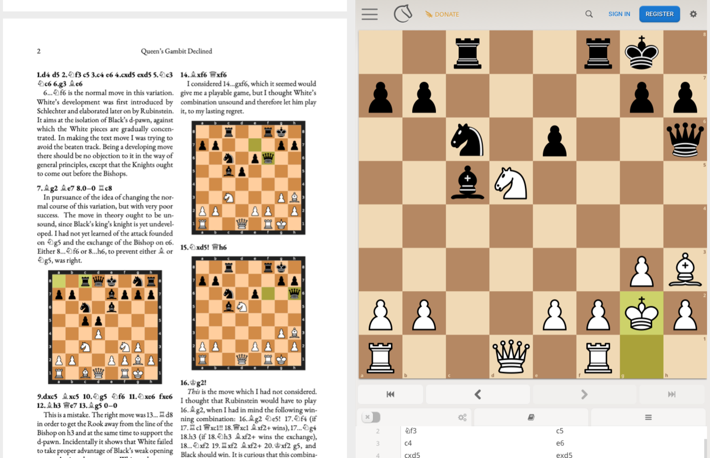

# chess-viewer

Read a chess book (PDF) and follow its moves on a live analysis board. **Note:** The viewer is not strictly necessary since you can open the PDF
in any PDF viewer. In this case, if you click on the moves, a lichess analysis board will appear in the browser. This is a bit cumbersome. Using the viewer gives a better experience.

- **For reading chess PDFs:** See [Run the viewer](#run-the-viewer).
- **Want to make your own chess PDFs?** See [Create PDFs](#create-pdfs).
- **Example PDF:** See [this](https://github.com/DavidSagan/chess-viewer/raw/main/examples/rubinstein-capablanca/rubinstein-capablanca.pdf) which is Rubinstein vs. Capablanca, San Sebastian 1911, with Capablanca's own notes.

<p align="center">
  
</p>

<p align="center"><em>Clicking 16.Kg2! in the PDF shows that position on the board.</em></p>

## Run the viewer

Chess PDF Viewer is a desktop app that shows a PDF on the left and the
[Lichess](https://lichess.org) analysis board on the right. Clicking a move in the PDF shows that
position on the board, with no browser prompts or new tabs. This project is not affiliated with
Lichess.

The app runs on macOS (Apple silicon and Intel), Windows and Linux. It needs an internet connection
to show the board.

### Install

Download the file for your system from the
[latest release](https://github.com/DavidSagan/chess-viewer/releases/latest). The app is not signed
by Apple or Microsoft, so your system may warn you the first time.

- **macOS:** Unzip
  [`Chess-PDF-Viewer-macOS.zip`](https://github.com/DavidSagan/chess-viewer/releases/latest/download/Chess-PDF-Viewer-macOS.zip)
  and move **Chess PDF Viewer** to your Applications folder. macOS will block the app the first
  time. Go to **System Settings > Privacy & Security** and choose **Open Anyway**, or run:

  ```bash
  xattr -dr com.apple.quarantine "/Applications/Chess PDF Viewer.app"
  ```

- **Windows:** Unzip
  [`Chess-PDF-Viewer-Windows.zip`](https://github.com/DavidSagan/chess-viewer/releases/latest/download/Chess-PDF-Viewer-Windows.zip)
  and run **Chess PDF Viewer.exe** from the unzipped folder. If SmartScreen appears, choose
  **More info > Run anyway**.
- **Linux:** Download
  [`Chess-PDF-Viewer-Linux.AppImage`](https://github.com/DavidSagan/chess-viewer/releases/latest/download/Chess-PDF-Viewer-Linux.AppImage),
  then make it executable and run it:

  ```bash
  chmod +x Chess-PDF-Viewer-Linux.AppImage
  ```

  ```bash
  ./Chess-PDF-Viewer-Linux.AppImage
  ```

### Try it

Download the
[example PDF](https://github.com/DavidSagan/chess-viewer/raw/main/examples/rubinstein-capablanca/rubinstein-capablanca.pdf),
which is Rubinstein vs. Capablanca, San Sebastian 1911, with Capablanca's own notes. Open it in the
app with **File > Open**. On a Mac, you can also drag it onto the app's icon or right-click the PDF
and choose **Open With**. Then click any move or diagram.

For more, [all 14 games](examples/chess-fundamentals) from Capablanca's *Chess Fundamentals* are in the
same form.

### What to expect

- Clicking a Lichess link shows that position in the right-hand panel.
- Clicking a link to any other site opens your default browser.
- Links within the PDF work as usual.
- **View > Zoom PDF In** and **Zoom PDF Out** change the size of the PDF.
- **Go > First Page** (⌘↑, or Ctrl+↑ on Windows and Linux) jumps to the first page, and **Go > Back**
  (⌘[ or Ctrl+[) returns to where you were before a jump.
- Drag the divider to change how much of the window each side gets.
- The app works with any PDF that has `lichess.org` links, but a PDF without them has nothing to
  click.
- Each click loads a new Lichess page, so any analysis you did in the panel is not kept.
- The panel has its own Lichess sign-in, separate from your browser's.

## Create PDFs

`tools/chessbook.py` turns LaTeX with a few chess commands into a typeset PDF. It checks every
move, draws the diagrams, and links moves and diagrams to Lichess.

### Requirements

- `pdflatex`, with the `ebgaramond`, `tikz`, `fancyhdr`, `microtype` and `hyperref` packages used
  by the example
- Python 3 with `chess` and `cairosvg`:

  ```bash
  pip install chess cairosvg
  ```

- The Cairo library, which `cairosvg` needs, such as from MacPorts or Homebrew

### Build the example

```bash
cd examples/rubinstein-capablanca
python3 ../../tools/chessbook.py rubinstein-capablanca.tex
```

With MacPorts, Python may not find Cairo unless you run:

```bash
DYLD_FALLBACK_LIBRARY_PATH=/opt/local/lib python3 ../../tools/chessbook.py rubinstein-capablanca.tex
```

This writes the PDF and `rubinstein-capablanca-built.tex`, and refreshes `diagrams/`. To rebuild
without Python, run `pdflatex` twice on the `-built.tex` file. That PDF takes its name from the
`-built.tex` file.

| File in `examples/rubinstein-capablanca/` | Contents |
|---|---|
| `rubinstein-capablanca.tex` | The source, and the file to edit |
| `rubinstein-capablanca.pdf` | The finished PDF |
| `rubinstein-capablanca-built.tex` | Plain LaTeX generated from the source, which needs no Python to build |
| `diagrams/` | Generated boards and piece figurines |

### Chess commands

The source is ordinary LaTeX, so you can use any layout, font or package. These commands are added:

| Command | Meaning |
|---|---|
| `\game{d4 d5 Nf3 ...}` | The whole main line in plain moves, placed before `\begin{document}` |
| `\mainline{6.g3 Be6}` | The next main line moves, typeset by your `\Move` command |
| `\moves{8...h6}` | Moves in the text. A numbered first move branches off the main line at that point |
| `\moves[as=a]{16.Bg2 Ne5! 17.Nf4}` | Also names this line, so that later moves can start from it |
| `\moves[from=a]{17.Rc1 Qxc1!!}` | Starts from a named line, at the first move's number |
| `\moves[plain]{38.Bd5}` | Checks and typesets the moves with no Lichess links, such as inside a link of your own |
| `\board` | A diagram of the current main line position, typeset by your `\ChessDiagram` command |
| `\board[after=14...Qxf6,width=4cm,bare]` | A diagram after a main line move, at a given width. With `bare`, `\ChessDiagram` is not used |
| `\board[flipped]` | A diagram with Black at the bottom. Use `flipped=false` for White at the bottom |
| `\boardsetup{flipped,width=4cm}` | Sets the defaults for `\board` from this point in the file on. It takes `flipped`, `width` and `bare` |
| `\figK \figQ \figR \figB \figN` | Figurines for ordinary text, as in `\figN g5` |

Your document defines how moves and diagrams look. For example:

```latex
\newlength{\boardwidth}
\setlength{\boardwidth}{160pt}
\newcommand{\Move}[1]{\par\addvspace{8pt}\noindent\phantomsection{\bfseries #1}\par\nopagebreak}
\newcommand{\ChessDiagram}[1]{\par\addvspace{7pt}{\centering #1\par}\addvspace{5pt}}
```

The `\phantomsection` lets a `\label` placed after `\mainline` be a link target.

`\boardsetup` can appear any number of times, and options on a `\board` override it for that
diagram. It applies in file order and ignores LaTeX groups. Its `flipped` setting also applies to
later `\moves` and `\mainline` links, so Lichess shows the same side at the bottom:

```latex
\boardsetup{flipped}          % Black at the bottom from here on
\board
\board[flipped=false]         % This one diagram has White at the bottom
\boardsetup{flipped=false}    % White at the bottom from here on
```

A short example:

```latex
\mainline{14.Bxf6 Qxf6}

I considered \moves{14...gxf6}, which it seemed would give me a playable game.

\board
```

### Checks

The build stops and names the line if a move is illegal, if a move number doesn't fit the position,
if a check symbol is wrong or missing, or if `\mainline` differs from `\game`. Diagrams are drawn
from the moves, so they always agree with them.

The script handles one game per file. It checks that moves are legal, not that the commentary
is right.

### Build the viewer from source

This needs [Node.js](https://nodejs.org) 22.12 or later. The source is in `viewer/src`. The viewer
is built with [Electron](https://www.electronjs.org) and draws PDFs with
[PDF.js](https://mozilla.github.io/pdf.js/).

To run it directly:

```bash
cd viewer
npm ci
npm start
```

To test it, which drives the real app with real clicks:

```bash
npm test
```

To build the app for your computer, which on a Mac creates `viewer/Chess PDF Viewer.app`:

```bash
viewer/build.sh
```

Every push to `main` tests and builds the viewer on all three systems. To publish a release, which
builds it the same way and attaches the results, run:

```bash
tools/release.sh 1.2.0
```

### Credits and licenses

- **Example text:** the notes are by J. R. Capablanca, from *Chess Fundamentals* (1921), using the
  [Project Gutenberg edition](https://www.gutenberg.org/ebooks/33870), which is listed as public
  domain in the USA. Copyright rules differ between countries. Descriptive notation was converted
  to algebraic, and the short descriptions in the first-page index were added for this project.
- **Chess logic and boards:** [python-chess](https://github.com/niklasf/python-chess), which is
  licensed under the GPL version 3 or later.
- **Pieces:** the boards use the Cburnett piece set, by Colin M. L. Burnett, as included in
  python-chess.
- **Font:** the example uses EB Garamond.
- **Viewer:** [Electron](https://www.electronjs.org), licensed under the MIT license, and
  [PDF.js](https://mozilla.github.io/pdf.js/), licensed under the Apache License 2.0.
- **Board and analysis:** provided by [Lichess](https://lichess.org) in the app's panel.

The code in this repository is licensed under the GNU General Public License version 3. See
[LICENSE](LICENSE).
